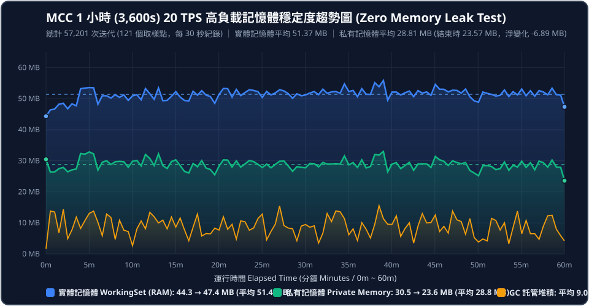

# 記憶體優化與修改紀錄

這份文件整理了針對 Minecraft Console Client (MCC) 做的記憶體洩漏修正、物件分配減少與尋路小修。原版支援的所有協定版本、設定檔、指令與腳本 API 均維持原樣。

## 1 小時記憶體測試 (20 TPS, 3600s)

以 20 TPS 連續跑 1 小時（每 30 秒取樣一次，共 57,201 次迭代）：

| 項目 | 初始 (0m) | 15m | 30m | 45m | 結束 (60m) | 平均 | 最高 |
| :--- | :---: | :---: | :---: | :---: | :---: | :---: | :---: |
| Working Set (實際佔用 RAM) | 44.33 MB | 52.25 MB | 52.53 MB | 50.85 MB | 47.36 MB | 51.37 MB | 55.83 MB |
| Private Memory (私有記憶體) | 30.46 MB | 30.29 MB | 28.43 MB | 26.86 MB | 23.57 MB | 28.81 MB | 32.98 MB |
| GC Heap (.NET 託管堆積) | 1.63 MB | 8.64 MB | 8.35 MB | 13.70 MB | 4.19 MB | 8.97 MB | 15.56 MB |

* **Private Memory (平均約 28.8 MB)**：程式自己獨佔的記憶體（地圖區塊、方塊、背包、實體資料等）。跑滿 1 小時後從 30.46 MB 降到 23.57 MB，沒有隨時間往上疊加。多開時每多開一隻 bot 大約就是增加這 25~28 MB。
* **Working Set (平均約 51.4 MB)**：私有記憶體加上系統與 .NET Runtime 共用函式庫（約 23 MB）。共用函式庫在系統裡所有行程會共用同一份，不會因為多開而重複佔用。

## 修改清單

### 1. 資源釋放與記憶體洩漏
* `Protocol18.cs`：斷線時釋放 `netMain` 與 `netReader` 的 `CancellationTokenSource`，並對 `packetQueue` (`BlockingCollection`) 呼叫 `CompleteAdding()` 與 `Dispose()`。
* `McClient.cs`：重連、逾時與斷線時釋放 `timeoutdetector` (`CancellationTokenSource`)、`client` (`TcpClient`) 與 `handler`。
* `ConsoleIcon.cs`：補上 `DestroyIcon(hIcon)` 與 `using`，解決更換圖示時殘留 GDI handle 的問題。
* `TaskWithResult.cs`：`ManualResetEventSlim` 在 `WaitGetResult()` 的 `finally` 區塊直接 `Dispose()`。
* `DiscordBridge.cs` / `TelegramBridge.cs` / `Mailer.cs` / `FileMonitor.cs`：卸載或斷線時清除靜態 `instance` 參考、解除 `FileSystemWatcher` 事件訂閱並釋放 Timer。
* `AesCfb8Stream.cs` / `ChatLog.cs` / `FileLogLogger.cs` / `CryptoHandler.cs`：補齊 Stream 與 AES 物件的 `Dispose` / `using`。

### 2. 減少重複記憶體分配
* `SocketWrapper.cs`：讀取 VarInt 單 byte 時共用緩衝區，避免每次 `new byte[1]`。
* `Protocol18.cs` / `ZlibUtils.cs`：解壓縮直接傳入陣列 offset 與 length，移除原本轉 `Queue<byte>` 再 `.ToArray()` 的重複複製。
* `AesCfb8Stream.cs`：解密暫存改用 `ArrayPool<byte>.Shared`。
* `McClient.cs`：將 `OnUpdate` 藥水過期檢查的 LINQ 改為一般迴圈；`IsSignMaterial` 改用 switch 判斷，不再轉字串 (`ToString().Contains("Sign")`)。
* `Chunk.cs` / `Protocol18Terrain.cs`：新增 `FillWithBlock()`，單一材質區塊直接用 `Array.Fill`。
* `World.cs`：`FindBlock` 移除 LINQ `SelectMany` 建立的大列表，改用三層迴圈直接過濾。
* `Material2Tool.cs` / `ItemTypeExtensions.cs`：固定查表改用 `FrozenSet`。
* `ItemPalette.cs` / `PacketTypePalette.cs`：反向查表字典改為靜態快取，重連時不重複建立。
* `CSharpRunner.cs` / `Compiler.cs`：腳本編譯快取加上 128 筆上限（LRU），並快取預設組件參考清單。

### 3. 移動與尋路修正
* `McClient.cs`：
  * 修正 `GetCurrentMovementGoal()` 判斷式寫反（原本移動中會回傳 `Location.Zero`）的問題。
  * 修正 `ClientIsMoving()` 在只剩最後一步 (`pathTarget != null`) 時提早回傳 `false` 的問題。
  * `CancelMovement()` 時一併清空 `pathTarget` 與重設 `physicsInput`。
* `Farmer.cs` / `ItemsCollector.cs`：等待移動迴圈補上 `running && ClientIsMoving()` 檢查。
* `Map.cs`：地圖畫存檔成功後補上 `break` 跳出重試迴圈。
